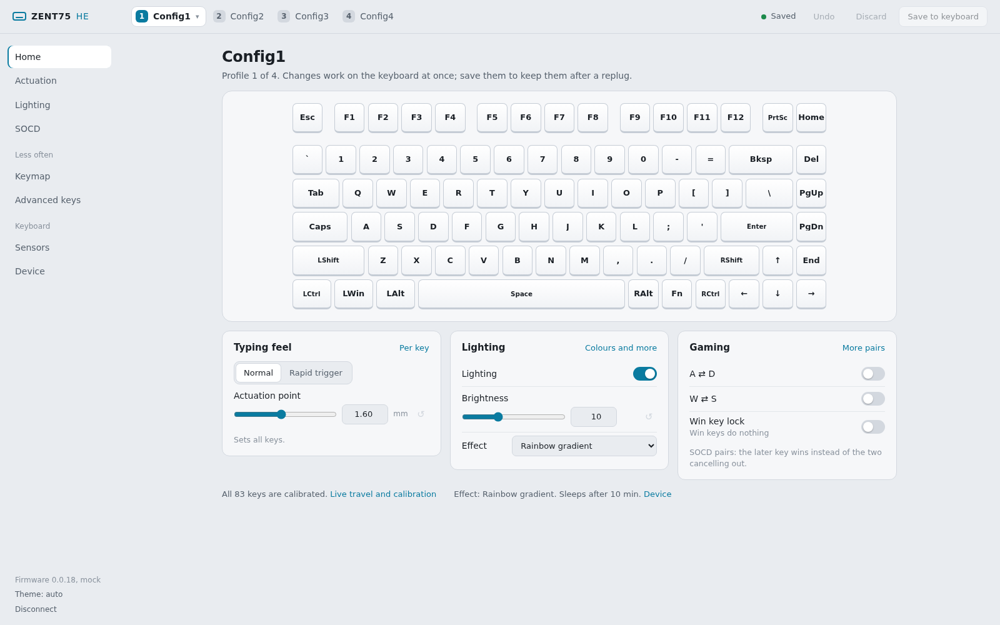
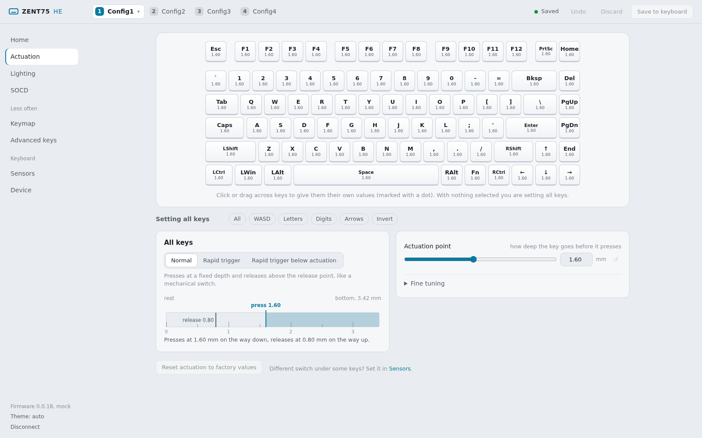

# zent75-rs

Open-source firmware and web configurator for the **HOVEY WORKS ZENT75-HE** hall-effect keyboard
(also sold as **Wob Lab ZENT 75 HE**; USB `36B0:357E`, 83 keys, 8 kHz polling, HPMicro HPM5361).

- **Firmware** (`firmware/`): a from-scratch **Rust** rewrite of the stock firmware on
  [embassy](https://embassy.dev) + [hpm-hal](https://github.com/hpmicro/hpm-hal). It replicates
  the original behaviour (the analog travel engine, calibration, actuation and rapid trigger,
  SOCD, key groups and DKS, RGB effects) and speaks the same configurator protocol with the same
  flash config layout, so it is a drop-in replacement that keeps your existing settings.
- **Panel** (`panel/`): a WebHID configurator that replaces the vendor's web driver. It works with
  both the stock firmware and this one, and exposes features the vendor UI never did.
- **Docs** (`docs/`): the hardware, flash map, boot chain, configurator protocol and stock
  algorithms, reverse-engineered and written down.

The vendor's own driver and firmware are at **https://hoveyworks-driver.com/**. This project is
not affiliated with or endorsed by HOVEY WORKS or Wob Lab.



<details>
<summary>Per-key actuation page</summary>



</details>

## Status

> [!WARNING]
> The firmware is **experimental**. It boots on the real keyboard, enumerates at USB high speed,
> scans at 8 kHz, talks to the configurator and enters the UF2 loader on request, but full
> end-to-end typing, config persistence and RGB are still being verified (see the checklist in
> [`docs/firmware-plan.md`](docs/firmware-plan.md#hardware-status)). Read
> [`docs/boot-recovery.md`](docs/boot-recovery.md) before flashing anything.

The panel is ready for daily use with the **stock** firmware.

| Part | State |
|---|---|
| Configurator panel | complete for stock 0.0.18; tap-hold, modifier masks, key mode 2 and custom switch curves for this firmware |
| Firmware core (`zent-core`) | stock behaviour reimplemented, `no_std`, `unsafe`-free, host-tested against recorded stock traces |
| Firmware board layer | runs on hardware; verification in progress |
| Simulator / emulator | host simulator behind a virtual HID device; unicorn-based HPM5361 emulator as a pre-flash gate |

### Planned

Matching the stock firmware is the first milestone, not the goal. Next:

- finish hardware verification and make the firmware a daily driver;
- features beyond stock: configurable tap-hold timing, more layers, a configurable number of
  profiles, macros, more flexible SOCD and DKS;
- better lighting effects and per-key lighting control from the panel;
- signed release builds with a simple flashing flow in the panel.

## Panel

```sh
cd panel
npm ci
npm run dev      # http://localhost:5173, open in Chrome / Edge / Brave (WebHID)
```

`http://localhost:5173/?mock=1` runs it against a built-in demo keyboard, no hardware needed.
Details: [`panel/README.md`](panel/README.md).

On Linux the browser needs access to the keyboard's hidraw nodes, e.g. a udev rule:

```
KERNEL=="hidraw*", ATTRS{idVendor}=="36b0", MODE="0666"
```

## Firmware

Prebuilt images are attached to [Releases](../../releases). To build (the pinned nightly toolchain
installs itself via `rust-toolchain.toml`):

```sh
cd firmware && ./package-uf2.sh   # → firmware/zent75-rs.uf2
```

Flash only through the guarded tool, which refuses anything outside the application region and so
never touches the boot header, stage-0 or the UF2 loader:

```sh
uv run --with unicorn --with capstone --with pyelftools python firmware/emu/run.py   # emulator gate
python3 tools/flash_uf2.py firmware/zent75-rs.uf2
```

**Recovery:** hold **A + S + D while plugging the keyboard in** to start the UF2 loader, then
flash the stock image (`tools/rollback.sh`, which also restores a config backup). The stock image
is not redistributed here; see [`firmware/vendor/README.md`](firmware/vendor/README.md).

More: [`firmware/README.md`](firmware/README.md).

## Repository layout

| Path | What |
|---|---|
| `docs/hardware.md` | MCU, flash map, key scan (ADC + mux), RGB, USB |
| `docs/protocol.md` | configurator HID protocol, RAM map, keymap codes |
| `docs/algorithms.md` | stock travel / calibration / actuation / SOCD / DKS behaviour |
| `docs/boot-recovery.md` | boot chain, flashing rules, recovery |
| `docs/firmware-plan.md` | firmware milestones and hardware verification status |
| `firmware/` | Rust firmware: `core/` (hardware-independent), `app/` (board), `sim/`, `emu/`, patched `hpm-hal/` |
| `panel/` | WebHID configurator (TypeScript + Vite) |
| `tools/` | Python device tools: backup (`dump_all.py`), verify (`restore.py`), guarded flashing, rollback |
| `AGENTS.md` | safety rules for anyone (human or AI agent) working on a live keyboard |

## Checks

```sh
cd tools && uv run --with pytest python -m pytest -q tests
cd panel && npx vitest run
cd firmware/core && cargo test --features std
cd firmware && ./package-uf2.sh
```

## License

Dual-licensed under [MIT](LICENSE-MIT) or [Apache-2.0](LICENSE-APACHE), at your option.
`firmware/hpm-hal/` keeps its upstream license. "HOVEY WORKS", "Wob Lab" and "ZENT" are
trademarks of their respective owners.
